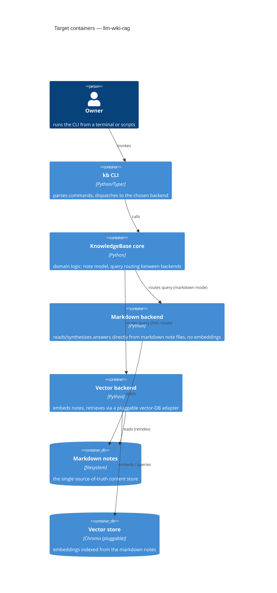

# Architecture map — llm-wiki-rag

> The **target foundation** (what we're about to scaffold), produced by `survey` in greenfield
> mode and read by specify / design / data-model / implement. No authored architecture doc exists
> yet; this map is the foundation baseline until `scaffold` materializes it and a later `survey`
> re-scan confirms the real repo matches.

## Stack

- Language / runtime: Python 3.12
- Frameworks: Typer (CLI), ChromaDB (first concrete vector-DB adapter, embedded/local)
- Build / test / lint: `pip install -e .` / `pytest` / `ruff check . && black --check .`

## C4 — system as it is

## Module inventory

| Module | Path | Layers | Wired at | Responsibility |
|---|---|---|---|---|
| cli | `src/kb/cli/` | ports (CLI adapter) | `src/kb/cli/main.py` (planned) | Typer commands: query, ingest, reindex; parses `--mode` flag |
| core | `src/kb/core/` | domain | `src/kb/core/knowledge_base.py` (planned) | KnowledgeBase domain type; routes a query to the selected backend behind a common interface |
| backends/markdown | `src/kb/backends/markdown/` | infra (adapter) | `src/kb/backends/markdown/backend.py` (planned) | direct markdown-file read + synthesis (Karpathy-style: title/summary/tags/content, folders like `inbox/`) |
| backends/vector | `src/kb/backends/vector/` | infra (adapter) | `src/kb/backends/vector/backend.py` (planned) | embeds notes, indexes/queries via a `VectorStore` port; Chroma is the first concrete implementation |
| config | `src/kb/config/` | infra | `src/kb/config/settings.py` (planned) | notes root path, backend selection defaults, vector-DB connection settings |

## Conventions (cited — the rules a new feature must match)

<!-- Target conventions for the scaffold; no code exists yet, so nothing is cited to a real file. -->

- **Module wiring / registration:** backends implement a shared `Backend` protocol (`query(text) -> Answer`); `core` resolves by name, no DI framework — plain constructor injection
- **Error handling:** a single `KbError` exception hierarchy; CLI catches at the top and prints a one-line message + exit code
- **IDs:** content-hash (SHA256 of note path + content) as the chunk ID for the vector backend, so re-ingesting unchanged notes is a no-op
- **Persistence / DB access:** markdown files on disk are the source of truth; the vector backend's `VectorStore` port wraps Chroma for now — no relational DB
- **Migrations:** none — no relational schema. Vector-index "migrations" are reindex runs, not schema migrations
- **Tests:** pytest; unit tests per module, integration tests exercise a real (temp-dir) Chroma instance, no mocking of the vector DB
- **Inter-module communication:** direct in-process calls only — this is a single-process CLI, no network/events between modules
- **UI / styling:** N/A — no frontend

## Datastores

| Store | Engine | Accessed via | Notes |
|---|---|---|---|
| Notes | Markdown files on local filesystem | `backends/markdown` (direct read), `backends/vector` (reindex source) | source of truth for both backends |
| Vector index | Chroma (embedded, local) | `backends/vector` via `VectorStore` port | pluggable — Chroma is the first adapter; other vector DBs implement the same port later |

## Frontend / UI foundation

<!-- N/A: no frontend -->

## Where things live / closest precedents

- A new backend (another vector DB, e.g. Qdrant) → `src/kb/backends/vector/`, implementing the same `VectorStore` port Chroma does; no precedent yet since this is the first backend pair being scaffolded.
- A new CLI command → `src/kb/cli/main.py`, modelled on the planned `query`/`ingest`/`reindex` commands.

## Constraints & known tech-debt

- Per-query backend switching (confirmed in `docs/idea-brief.md` §7) requires the vector index to stay in sync with the markdown source of truth — the reindex trigger mechanism (on-demand command vs. file-watch) is an open design decision, not yet fixed.
- Only one vector-DB adapter (Chroma) exists at scaffold time; "any vector database" from the idea brief is a pluggability goal for the `VectorStore` port, not a guarantee every vector DB is implemented now.

## Reconciliation with the authored architecture doc

No authored architecture doc exists; this map is the current reference (the greenfield-bootstrap target foundation).
