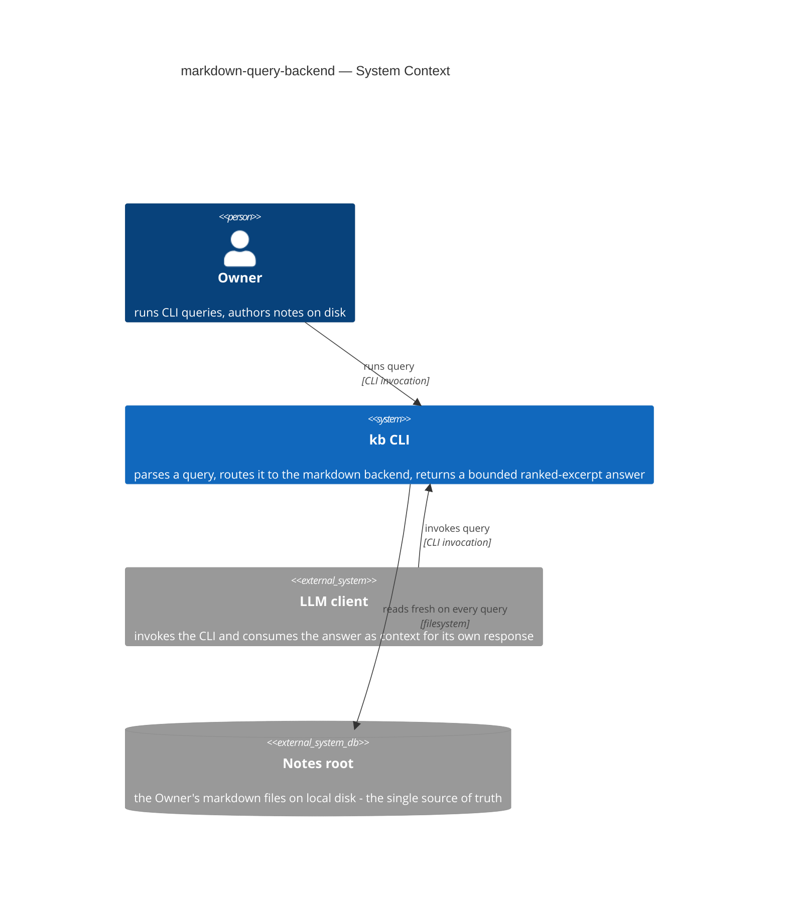
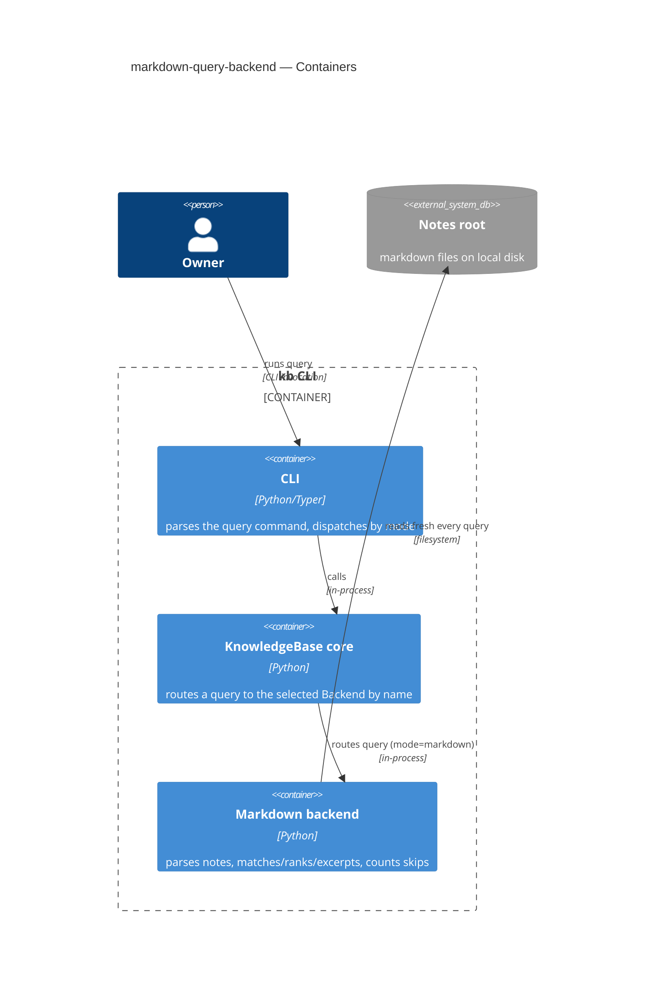
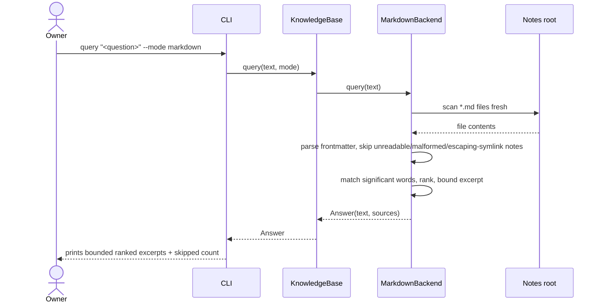
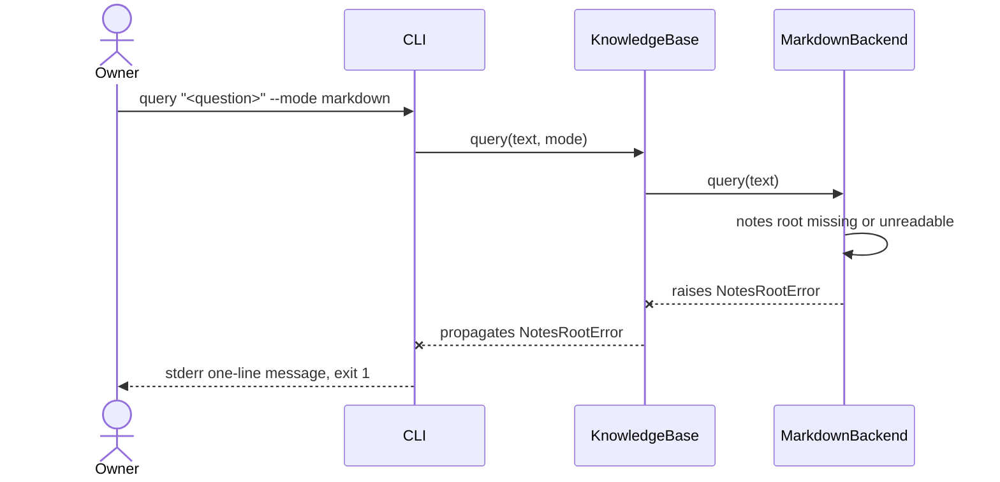
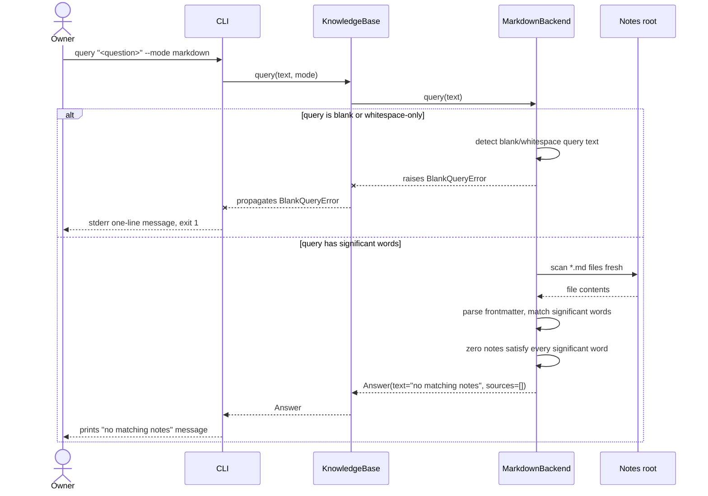
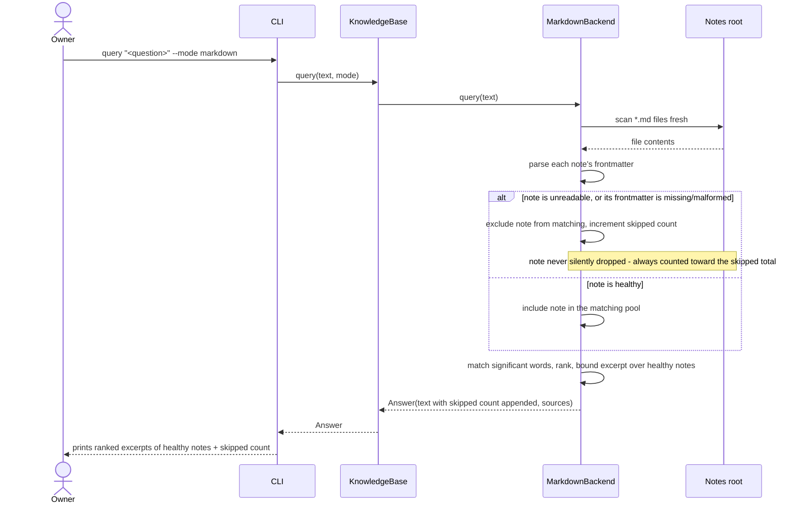
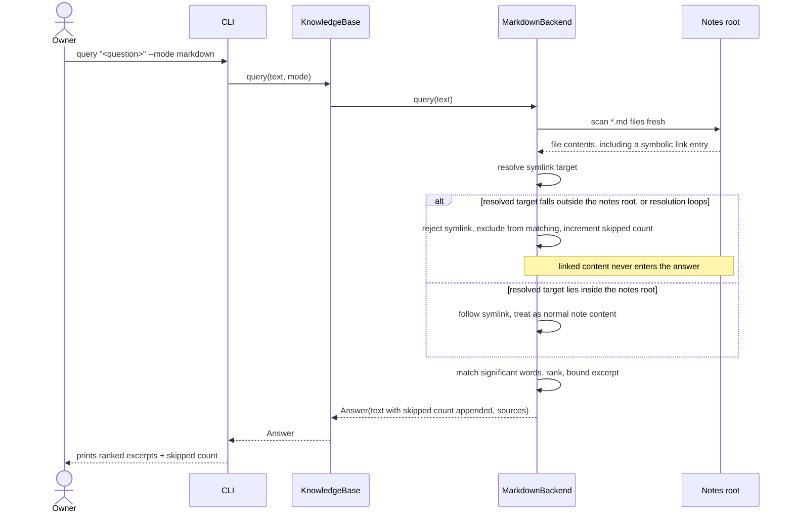

# Software Architecture Document — markdown-query-backend

## 1. Introduction and goals

**Intent.** The Owner keeps a personal markdown notes folder and queries it from the `kb` CLI — typically via an LLM client that passes a natural-language question on the Owner's behalf. This feature replaces the markdown backend's placeholder (a literal substring scan that dumps whole files) with a real implementation: it matches a query by requiring every significant word to appear somewhere in a note (Frontmatter or body), ranks Frontmatter-complete matches above body-completed ones, and returns a bounded, focused excerpt per matching note — plus a count of notes it had to skip — instead of whole-file dumps.

**Top-3 quality goals (1-liners; full scenarios in §10):**

1. Correctness — multi-word, word-presence matching returns the notes a reader would actually expect, ranked Frontmatter-first with a stable tiebreak (AC-01, AC-02, AC-02b).
2. Robustness — no silent note loss: one malformed or unreadable note is skipped and counted, never hidden, and never breaks the rest of the query (AC-06, AC-07).
3. Performance — a fresh, unindexed scan stays within interactive latency bounds at the documented scale (spec §6 NFR: p95 ≤ 500 ms @ 300 notes, ≤ 100 ms @ 50 notes).

**Stakeholders.**

| Role | Interest | Sign-off owner? |
|---|---|---|
| Owner | gets trustworthy, focused answers from their own notes; the only actor in this system (root CONTEXT.md) | No |
| LLM client | consumes the Answer text as bounded context for its own response; never talks to the backend directly, only through the CLI | No |
| Tech Lead (Andrii Sidun, same person as Owner) | SAD approval | Yes |

**Decision overrides (¶4).**
- Decision override: spec §1 commits to extending the shared `Answer` result (both backends, ADR 0002) with a skipped-note count field. This design narrows that for v1: per spec §8 OQ3's own stated default, the skipped count is surfaced as plain text appended to `Answer.text`, not a new dataclass field — `Answer` keeps its current 2-field shape (`text`, `sources`; `src/kb/core/knowledge_base.py`). Rationale: OQ3 explicitly defers the structural question ("inline text vs. separate field") to `sdd:api`; deciding it here would pre-empt that stage. The vector backend remains free to choose a field-based shape later without this feature having locked the port's data shape.

## 2. Constraints

**Technical.**
- Python 3.12
- Typer ≥0.12 (existing CLI framework — no new framework)
- No new datastore — markdown files on local disk remain the sole source of truth (ADR 0003); no relational DB, no migrations
- Hexagonal-lite: backends implement the `Backend` protocol (`query(text) -> Answer`); `KnowledgeBase` core resolves by name via plain constructor injection, no DI framework (ADR 0002)
- New dependency for Frontmatter parsing — see **ADR-0002** (`PyYAML` added to the **base** `dependencies`, not the optional `vector` extra)

**Organisational.**
- Solo-owner personal project — Andrii Sidun is Owner, Architect, and sole implementer
- Size S (`.size`) — roughly one PR, about a week of effort
- No hard calendar deadline; roadmap step 3 (vector backend) is blocked on this landing, but no date is committed

**Conventions.**
- `CLAUDE.md` is the project's convention file: module layout (`src/kb/cli/`, `src/kb/core/`, `src/kb/backends/markdown/`, `src/kb/backends/vector/`, `src/kb/config/`), `Backend` protocol wiring, a single `KbError` hierarchy caught once at the CLI top, content-hash IDs (vector backend only — not used here), direct in-process calls only
- Tests: pytest; integration tests for this backend use a real temp-dir notes fixture (frontmatter + malformed notes + symlinks), mirroring the existing "never mock the vector DB" convention applied to the filesystem instead of Chroma

**Regulatory / external.**
- N/A — Internal data classification, no new personal data, no compliance surface, no multi-tenant boundary (spec §6.1)

## 3. Context and scope

The Owner runs the `kb` CLI locally; the Owner (or, typically, an LLM client acting on the Owner's behalf) issues a natural-language query; the CLI's `query` command routes it through `KnowledgeBase` to the markdown backend when `mode=markdown` (the default). The backend scans the Owner's notes root fresh on every call — no index, no cache — and returns a bounded set of ranked, excerpted matches plus a skipped-note count.

<!-- brownfield: real src/kb/ scaffold exists (post a0cd487: KnowledgeBase/Backend/Answer/KbError wired, CLI query command live); the markdown backend is a literal placeholder stub this feature replaces, not new wiring. -->

**External systems (in / out):**

| Actor or system | Type | Interaction |
|---|---|---|
| Owner | Person | authors/edits notes on disk; runs CLI queries directly or via an LLM client |
| LLM client | System (external, local) | invokes the CLI's `query` command; consumes the bounded Answer text as context |
| Notes root | System (internal, local disk) | markdown files read fresh on every query — the single source of truth |

**C4 Context (L1):**



The system boundary is the `kb` CLI process itself. The LLM client and the Owner both sit outside it as callers; the notes root sits outside it as the trusted (but externally-mutable) content store the backend reads from — trust ends at the notes-root boundary itself (AC-08's symlink-escape rule exists precisely because content *inside* that folder is trusted, content resolved to *outside* it is not).

## 4. Solution strategy

**Top strategic choices (the seeds for ADRs):**

1. **Target surface: `cli` only.** The whole product is explicitly CLI-only (`CLAUDE.md`: "CLI-only — no HTTP/MCP server"; roadmap "Out of scope: An MCP server or HTTP API interface"). A single surface with no legitimate alternative given that standing constraint — decided inline, not an ADR. Sets frontmatter `target_surfaces: [cli]`.
2. **Word-presence matching: single-tier match rule (no separate frontmatter-present/absent case), two rank buckets (Frontmatter-complete vs. body-completed), path-order tiebreak.** Inherited directly from spec §1's committed approach and its three Decision-override bullets (already settled during `specify`/`clarify`): this design operationalizes it (stopword-filtered tokenization, per-field/body presence check, boolean two-bucket rank, stable sort by path) rather than re-litigating it.
3. **Raise a dedicated `KbError` subclass for a bad/missing notes root, instead of the stub's current soft Answer-embedded message.** Aligns the backend with the project's one documented `KbError` → CLI-catches-at-top → exit-non-zero convention, and satisfies AC-04b's "distinct configuration error" requirement precisely. This also fixes a real inconsistency the brownfield scan found: today's stub returns an `Answer` with the error baked into `.text` (exit 0), which the CLI's own convention never expects from a configuration failure. → **ADR-0001** (multi-module: touches the core error hierarchy, the CLI's exit-code contract, and the existing `test_smoke.py` assertion; has a legitimate alternative — keep the softer Answer-embedded message, less rework but perpetuates the inconsistency).
4. **No new datastore, no caching, single-pass synchronous scan per query.** Inherited from spec §3 Non-goals + ADR 0003 (markdown as source of truth). The NFR's latency budget (≤500 ms @ 300 notes) is met by a synchronous `Path.rglob` walk with no concurrency — consistent with the non-goals' own scale ceiling ("a few hundred files").
5. **Add `PyYAML` as a new base (non-optional) dependency for Frontmatter parsing.** The repo declares no YAML/frontmatter library today; markdown is the default mode and must work without the `vector` extras installed. A genuine choice among legitimate alternatives (`PyYAML` + a hand-rolled `---` delimiter split, `python-frontmatter`, or a fully hand-rolled parser) that touches the installed base dependency set for every user. → **ADR-0002**.

Each tactical decision in later sections traces to one of these four seeds; none of them contradicts an existing repo-level ADR.

## 5. Building block view

Hexagonal-lite (ADR 0002): the markdown backend is one adapter behind the `Backend` protocol. Internally it is not its own layered architecture — it is a small, straight-line pipeline (parse note → classify skip/healthy → match → rank → excerpt → format), matching the existing vector backend's own `backend.py` + `chroma_store.py` split in spirit (one orchestrator file, one or two focused helper files).

**Internal decomposition:**

```
src/kb/backends/markdown/
├── backend.py     <MarkdownBackend.query(text) -> Answer; wires the pipeline; raises NotesRootError>
├── note.py        <Note dataclass (path, frontmatter dict, body); parse_note(path, notes_root) -> Note,
│                    raising/flagging a skip reason for unreadable files, missing/malformed Frontmatter,
│                    or a symlink that escapes the notes root / loops>
└── excerpt.py      <significant-word tokenizer + stopword filter, word-presence match, two-bucket
                      Frontmatter-boosted rank with path-order tiebreak, block-aware bounded excerpt>
```

`backend.py` never reads file content directly — `note.py` owns all filesystem/parsing concerns (including the symlink check from AC-08), and `excerpt.py` owns everything that is purely text-in/text-out (matching, ranking, excerpting) and is therefore unit-testable without touching a filesystem at all.

**C4 Container (L2):**



One container per declared target surface (`cli`): the `CLI` container is that surface's entry point; `KnowledgeBase core` and `Markdown backend` are internal containers behind it, not separate surfaces. The vector backend and its own containers (out of scope for this feature) are omitted here — see `docs/architecture-map.md` for the full system view.

## 6. Runtime view

**Critical flow 1: Owner asks a multi-word question, gets a ranked, excerpted answer**



**Critical flow 2: Bad notes root reported as a distinct configuration error (ADR-0001)**



**Critical flow 3: No notes match, or the query itself is blank**



**Critical flow 4: A malformed note is skipped while healthy notes still match**



**Critical flow 5: A symlink escaping the notes root is rejected**



## 7. Deployment view

<!-- N/A: reuses the existing deployment unit (the local `kb` CLI process, run directly by the Owner). This feature changes code inside the existing markdown-backend module only — no new process, no new infra. -->

## 8. Crosscutting concepts

| Concept | Convention | Where defined |
|---|---|---|
| Error handling | Single `KbError` hierarchy; CLI catches at the top, prints one line to stderr, exits non-zero. This feature adds `NotesRootError(KbError)` for a missing/unreadable notes root (ADR-0001) and, by the same convention, a `BlankQueryError(KbError)` for a blank/whitespace-only query (AC-05) — both are caller/configuration-input errors, raised once per call. All other skip-worthy *note* failures are per-note and counted, never raised; a query with zero matches (no bad input, no bad notes root) returns a normal `Answer` with an explicit "no matching notes" text (AC-04), not an error. | CLAUDE.md "Errors"; ADR-0001 |
| Skip accounting | A note is skipped (excluded from matching, counted in the total) when it is unreadable as a file, or its Frontmatter block is missing/unparsable (AC-06). Never skipped and never counted when it is not a `.md` file, or sits under a dot-prefixed file/directory (AC-10). | spec AC-06, AC-10; §5 `note.py` |
| Symlink handling | A symlink is resolved via `Path.resolve()`; rejected and counted as skipped when the resolved target falls outside the notes root (`is_relative_to` check) or resolution raises (a loop); otherwise followed and searched normally. | spec AC-08; §5 `note.py` |
| Matching | A significant word = a query token after lowercasing and filtering a small common-English stopword list; "present" = case-insensitive substring anywhere in Frontmatter (title/summary/tags) or body (AC-01). | spec AC-01, spec §8 OQ2 default |
| Ranking | Two rank buckets, single-tier match rule: a note whose Frontmatter alone satisfies every significant word ranks above one that needed its body too; ties broken by ascending note path (AC-02, AC-02b). | spec AC-02, AC-02b |
| Excerpting | Bounded to ~5 lines of block-aware context (a fenced code block or table row is never split) around the passage with the most significant-word hits, first-occurrence tiebreak; at most the top 10 ranked notes per answer. | spec §8 OQ1 default — this design fixes the exact numbers (5 lines, top 10) |
| Result surfacing | The skipped-note count is appended as a plain-text note at the end of the answer text. | spec §8 OQ3 default — the exact surfacing *format* stays an open question until `sdd:api` |
| Internationalisation | N/A — single language, no i18n concern | — |
| Observability | N/A — no new logging/metrics; KPIs (spec §7) are a manual, unmeasured self-review | spec §7 |
| ID strategy | N/A — this feature introduces no new IDs; content-hash IDs remain scoped to the vector backend only | CLAUDE.md "IDs" |
| Persistence | Markdown files remain the sole source of truth; no index, no cache; every query re-scans fresh (AC-09) | ADR 0003; spec §3 Non-goals |

## 9. Architecture decisions

| # | Title | Status | Section |
|---|---|---|---|
| 0001 | Raise a dedicated KbError subclass for a missing or unreadable notes root | Accepted | §4 |
| 0002 | Use PyYAML with a hand-rolled delimiter split for Frontmatter parsing | Accepted | §2 |

ADR files live under `docs/features/markdown-query-backend/adr/NNNN-<title>.md`.

<!-- Two ADRs fired for this S-size feature (within the typical 2-4 range): most architecturally
     consequential calls — word-presence matching, Frontmatter-required single-tier match rule,
     path-order tiebreak — were already settled as Decision-override bullets during specify/clarify,
     so design operationalizes them rather than re-deciding them. The two calls that genuinely
     crossed the blast-radius gate during this pass were the error-reporting convention (ADR-0001)
     and the Frontmatter-parsing dependency choice (ADR-0002). -->
<!-- Critic resolution: a clean-context critic pass flagged the §1 Answer-shape override, the
     single-tier/two-tier vocabulary clash (now unified), the PyYAML gate-skip (now ADR-0002), and
     AC-04/AC-05 coverage gaps (now carried in §8's Error-handling row and QG-1 below) — all four
     resolved by amendment before this document was committed. -->

## 10. Quality requirements

**QG-1. Correctness — multi-word word-presence matching**
- **When:** the Owner queries with a multi-word question whose significant words are scattered across a note's Frontmatter and body.
- **Then:** the system returns the note as a match (AC-01) and ranks a Frontmatter-complete match above a body-completed one, with a stable path-order tiebreak among ties (AC-02, AC-02b); when no note matches, an explicit "no matching notes" `Answer` is returned (AC-04); when the query itself is blank/whitespace-only, `BlankQueryError` is raised instead of matching against every note (AC-05).
- **How verify:** integration tests against a fixture notes set asserting the match set and exact rank order for seeded ties, plus explicit no-match and blank-query cases.

**QG-2. Robustness — no silent note loss**
- **When:** the notes root contains at least one unreadable or malformed-Frontmatter note alongside otherwise-healthy notes.
- **Then:** the broken note is excluded from matching, counted in the skipped total, and never prevents the healthy notes' matches from being returned (AC-06, AC-07); 0 notes are ever excluded from an answer without being counted in the skipped total.
- **How verify:** a test-suite assertion against a fixture containing ≥1 malformed note (spec §6 NFR row, verbatim).

**QG-3. Performance — interactive latency at documented scale**
- **When:** a single query runs over a notes root of up to a few hundred notes.
- **Then:** p95 latency ≤ 500 ms over a 300-note fixture (each note ~2–5 KB of body text, at least one long enough to exercise the bounded-excerpt path; p95 measured across 20 distinct representative queries, each run once); p95 ≤ 100 ms over a ~50-note fixture, same methodology (spec §6 NFR rows, verbatim).
- **How verify:** wall-clock timing test against the synthetic fixtures described above.

## 11. Risks and technical debt

| Risk / debt | Severity | Mitigation | Owner |
|---|---|---|---|
| The exact excerpt bound (5 lines) and result cap (top 10) are design-time defaults, not yet validated against real day-to-day usage | Low | Revisit after the 30-day KPI self-review (spec §7); both numbers are isolated to `excerpt.py`, cheap to tune | Andrii Sidun |
| `PyYAML` becomes a new mandatory (non-optional) base dependency (ADR-0002) | Low | Small, ubiquitous, pure-Python-adjacent dependency; swapping it later is cheap and confined to `note.py` | Andrii Sidun |
| `tests/test_smoke.py` currently asserts the *old* soft-error behavior (exit 0, message in stdout) for a missing notes root | Low | Update the test in the same PR that lands ADR-0001's `NotesRootError` change | Andrii Sidun |
| Open architectural decision: exact surfacing format for the skipped-note count (inline text vs. a separate structured field) | Open question | Resolve before `sdd:api`; default for now is a plain-text note appended to the answer (spec §8 OQ3) | Andrii Sidun |

**Accepted debt (acceptable in v1, plan to fix later):**
- No in-process caching of parsed notes between queries, even within a single session — correct per AC-09 (always reflect on-disk state) and an explicit non-goal; acceptable while the notes collection stays in the few-hundred-file range the NFR is scoped to.

## 12. Glossary

| Term | Meaning |
|---|---|
| Owner | the single person who authors notes and runs the `kb` CLI — the only actor in this system (root CONTEXT.md) |
| Backend | one of the interchangeable retrieval implementations (`markdown` or `vector`) behind the shared `Backend` protocol (root CONTEXT.md) |
| Note | one markdown file under the notes root — the atomic unit either backend reads (root CONTEXT.md) |
| Notes root | the filesystem folder holding all notes; the single source of truth both backends read from (root CONTEXT.md) |
| Query mode | the per-call selector (`markdown` or `vector`) naming which backend answers a given query (root CONTEXT.md) |
| Frontmatter | the required structured header block (title, summary, tags) at the top of every note; a note missing it, or whose block can't be parsed, is skipped — never optional (feature CONTEXT.md) |
| Match | a note whose Frontmatter or body contains every significant word of the query — word-presence based, not exact-phrase (feature CONTEXT.md) |
| Excerpt | the focused, block-bounded snippet of text around a match, returned instead of the whole note (feature CONTEXT.md) |
| Significant word | a query token after lowercasing and common-English stopword filtering (this design, §8) |
| Skipped note | a note excluded from matching and counted in the skipped total because it is unreadable or has a missing/unparsable Frontmatter block (spec AC-06) |
