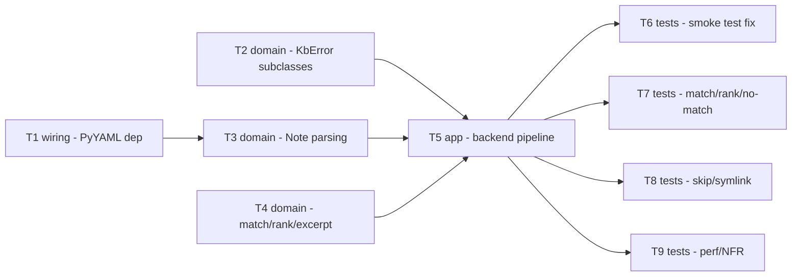

# Epic — markdown-query-backend

> **Spec:** [spec.md](../spec.md) · **Design:** [sad.md](../sad.md) · **Data model:** [data-model.md](../data-model.md) · **ADRs:** [adr/](../adr/) · **CLI contract:** [contracts/cli.md](../contracts/cli.md)

## Goal

Replace the markdown backend's placeholder (literal substring scan, whole-file dumps) with a real implementation that matches multi-word natural-language questions by word-presence, ranks Frontmatter-complete matches first, returns bounded per-note excerpts instead of whole files, and never silently drops a malformed note — so roadmap step 3 (vector/RAG backend) has a working, trustworthy markdown counterpart to build alongside (spec §2 Goals).

## Scope

- **In:** `src/kb/backends/markdown/` (new `note.py`, `excerpt.py`, rewritten `backend.py`), two new `KbError` subclasses in `src/kb/core/knowledge_base.py`, a new base dependency (`PyYAML`), the existing `tests/test_smoke.py` fix, and new integration + performance tests under `tests/backends/`.
- **Out (spec §3 Non-goals):** semantic/fuzzy/embeddings matching (vector backend, roadmap step 3); automatic reindexing or caching between queries; enforcing the Owner's note-folder structure; true relevance scoring (BM25/TF-IDF); notes collections beyond a few hundred files.

## Task map

## Tasks

See [tracker.md](./tracker.md) for status. Machine contract: [tasks.json](../tasks.json).

| # | Task | Layer | Blocked by | DoD (short) |
|---|---|---|---|---|
| T1 | Add PyYAML as a base dependency | wiring | — | `pip install -e .` resolves PyYAML without `[vector]` |
| T2 | Add NotesRootError/BlankQueryError | domain | — | Both are `KbError` subclasses, unit-tested |
| T3 | Implement Note parsing + skip/symlink detection | domain | T1 | `parse_note` unit tests pass for all skip reasons |
| T4 | Implement matching/ranking/excerpting | domain | — | Unit tests cover stopwords, ranking, excerpt bounds |
| T5 | Wire MarkdownBackend.query() pipeline | app | T2, T3, T4 | End-to-end pipeline raises/returns per `sad.md` §6 flows |
| T6 | Update test_smoke.py | tests | T5 | Asserts exit 1 for `NotesRootError` |
| T7 | Integration tests: match/rank/no-match/blank/fresh-scan | tests | T5 | AC-01/02/02b/03/03b/04/05/09 all pass |
| T8 | Integration tests: skip/symlink/non-md | tests | T5 | AC-06/07/08/10 all pass |
| T9 | NFR performance test | tests | T5 | p95 ≤500ms@300 notes, ≤100ms@50 notes |

## Risks / Hard rules

- No caching/indexing between queries (spec §3 Non-goal; AC-09) — every query re-scans fresh.
- `backend.py` never reads file content directly — all filesystem/parsing concerns live in `note.py` (sad.md §5).
- Per-note failures (AC-06/07/08) are counted, never raised; only a bad notes root (AC-04b) or a blank query (AC-05) raise a `KbError` (sad.md §8 Error handling).
- `tests/test_smoke.py`'s existing assertion of the old exit-0 behavior must be fixed in the same change that lands ADR-0001 (sad.md §11 risk row) — T6 exists precisely for this.
