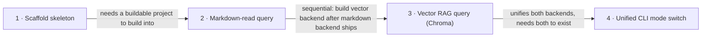

# Roadmap — llm-wiki-rag

> **A decomposition, not a promise.** The overall idea broken into incremental steps: what each
> step is, where it comes from, how big it is — or that nobody has looked at it yet — and in which
> order, and parallel lanes, we walk them. **No dates** (except shipped history), **no scores** —
> order is the prioritization. The *solution* for any step lives in its `docs/features/<slug>/`
> spec, not here.

## Destination

The owner can query one personal markdown knowledge base from the CLI, choosing per query whether to get a direct-markdown-read answer or a RAG answer from a vector database, with both modes reading from the same notes folder.

## Steps

| # | Step | Source | Size | Status |
|---|---|---|:---:|---|
| 1 | Scaffold the project skeleton (Python package, CLI entrypoint, test harness, Chroma adapter scaffolding, CI) | `docs/architecture-map.md` §Stack + `docs/features/_scaffold/tasks.json` | S | idea |
| 2 | Query via direct markdown read (Karpathy-style backend: reads notes directly, no embeddings) | `docs/idea-brief.md` §7 | M | idea |
| 3 | Query via RAG against Chroma (embeds notes, manual reindex command, vector-mode query) | `docs/idea-brief.md` §7; `docs/adr/0001-use-python-typer-chroma-stack.md` | M | idea |
| 4 | One CLI command with a per-query mode switch unifying both backends | `docs/idea-brief.md` §7 ("Switch mechanism") | S | idea |

## Not yet specified

| Area | What we'd have to learn | Blocks | How it gets sharpened |
|---|---|:---:|---|
| Automatic reindex / staleness detection for the vector index | Whether file-watch or an explicit manual command is enough, and if auto-reindex is wanted at all | 3 | A grilling conversation with the owner (see Open decisions D1), or a recon pass once step 3 is spec'd |
| Second vector-DB adapter beyond Chroma | Which vector DB (if any) to support next, and whether the current `VectorStore` port shape generalizes to it | — | A recon pass once a concrete second target is named (see Open decisions D2) |

## Out of scope

- An MCP server or HTTP API interface — owner confirmed CLI-only during `survey`'s intent check (`docs/idea-brief.md` §3).
- Extending the existing installed `llm-wiki` Claude Code plugin instead of building a standalone tool — `docs/idea-brief.md` §5.

## Open decisions

| # | Question | Type | Owner | Blocks |
|---|---|:---:|:---:|:---:|
| D1 | Should the vector index reindex automatically (file-watch) or stay manual-only for v1? | grilling | human | 3 |
| D2 | Which second vector database, if any, should be supported after Chroma? | grilling | human | — |

## Decisions so far

- Standalone CLI tool, not an extension of the existing `llm-wiki` plugin → [`docs/idea-brief.md`](idea-brief.md) §5, §7
- Stack: Python 3.12 + Typer + Chroma → [`docs/adr/0001-use-python-typer-chroma-stack.md`](adr/0001-use-python-typer-chroma-stack.md)
- Backends structured as interchangeable ports behind a `KnowledgeBase` core → [`docs/adr/0002-hexagonal-lite-pluggable-backends.md`](adr/0002-hexagonal-lite-pluggable-backends.md)
- Markdown files are the single source of truth; no relational database → [`docs/adr/0003-markdown-as-source-of-truth.md`](adr/0003-markdown-as-source-of-truth.md)

## Dependency graph

## Execution path

| Wave | Steps | Zone per step (why parallel-safe) | Unlocks |
|:---:|---|---|---|
| 1 | 1 | whole repo (new) | 2 |
| 2 | 2 | `src/kb/backends/markdown/` (new) | 3 |
| 3 | 3 | `src/kb/backends/vector/` (new) | 4 |
| 4 | 4 | `src/kb/cli/` + `src/kb/core/` (new) | — |

## Shipped

| Step | Shipped | Link |
|---|---|---|
